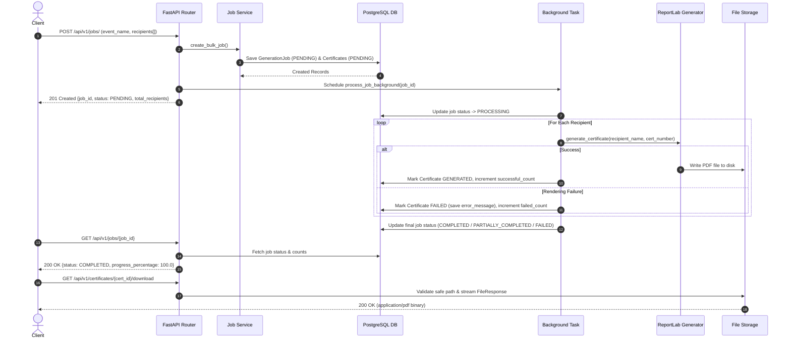

# Bulk Certificate Generator API & Admin Dashboard

[](https://www.python.org/)
[](https://fastapi.tiangolo.com/)
[](https://www.sqlalchemy.org/)
[](https://www.postgresql.org/)
[](https://docs.pytest.org/)
[](https://react.dev/)

A production-ready, highly modular backend API built for asynchronous bulk certificate generation, job progress tracking, fault-tolerant PDF rendering, and secure certificate retrieval. Includes an optional enterprise light SaaS administration dashboard.

---

## 1. Project Overview & Problem Statement

Organizations and educational platforms frequently issue hundreds or thousands of participation certificates after workshops, webinars, or training bootcamps. Generating these PDFs synchronously during an HTTP request causes request timeouts, server resource exhaustion, and poor user experience. Furthermore, if a single recipient's record contains malformed data or fails to render, standard naive batch scripts crash entirely, abandoning the remaining valid certificates.

### Key Objectives Achieved:
1. **Asynchronous Non-Blocking Execution**: Accepts bulk requests instantly (HTTP 201) and delegates PDF rendering to background worker threads.
2. **Failure Isolation**: Wraps individual certificate generation in dedicated try/except blocks. A failure on 1 recipient increments `failed_count` and records the error message without halting the remaining job queue.
3. **Progress Tracking**: Exposes real-time job metrics including total, successful, failed, pending counts, and progress percentage.
4. **Secure Certificate Retrieval**: Enforces filesystem path traversal checks (`is_safe_path`) and dynamic filename sanitization before streaming PDFs via HTTP.

---

## 2. Technology Stack

- **Backend Framework**: Python 3.10+ & FastAPI
- **Database & ORM**: PostgreSQL, SQLAlchemy 2.0 (Declarative Base), Alembic for migrations
- **Validation**: Pydantic v2 & `email-validator`
- **PDF Generation**: ReportLab (Landscape A4 layout with elegant gold/navy borders and dynamic text formatting)
- **Testing**: Pytest & FastAPI `TestClient` (100% test pass rate across unit, validation, failure handling, and download endpoints)
- **Containerization**: Docker & `docker-compose`
- **Admin Dashboard**: React 18, TypeScript, Vite, Tailwind CSS (3 Enterprise Light Themes)

---

## 3. Architecture & System Flow

The project follows a clean layered architecture separating API routes, business service logic, database repository access, and models.

```
Client (Postman / React UI)
        |
        v
  [ FastAPI Routes ] (api/routes/jobs.py, certificates.py)
        |
        +---> [ Pydantic Schemas & Validators ]
        |
  [ Service Layer ] (services/job_service.py, certificate_service.py)
        |
        +----------------------------+
        | (Sync HTTP Response)       | (Background Execution)
        v                            v
  [ DB Repository ]          [ Background Worker Task ]
  (models/job.py)                    |
                                     v
                        [ ReportLab PDF Generator ] (services/pdf_service.py)
                                     |
                                     v
                        [ Local Storage / PDF Files ] (storage/certificates/)
```

### Sequence Flow Diagram



---

## 4. Database Design

```mermaid
erdiagram
    GENERATION_JOBS ||--o{ CERTIFICATES : "contains"
    
    GENERATION_JOBS {
        string id PK "UUID"
        string event_name "Indexed"
        string event_date
        enum status "PENDING, PROCESSING, COMPLETED, PARTIALLY_COMPLETED, FAILED"
        int total_recipients
        int successful_count
        int failed_count
        datetime created_at
        datetime started_at
        datetime completed_at
    }

    CERTIFICATES {
        string id PK "UUID"
        string job_id FK "References generation_jobs.id"
        string recipient_name
        string recipient_email "Indexed"
        string certificate_number UK "Indexed (CERT-XXXX-XXXX)"
        enum status "PENDING, GENERATED, FAILED"
        string file_path
        text error_message
        datetime created_at
        datetime generated_at
    }
```

---

## 5. API Endpoints Documentation

| Method | Endpoint | Description | Status Code |
| :--- | :--- | :--- | :--- |
| `POST` | `/api/v1/jobs/` | Create a new bulk certificate generation job | `201 Created` |
| `GET` | `/api/v1/jobs/{job_id}` | Check status, progress %, and metrics for job | `200 OK` |
| `GET` | `/api/v1/jobs/{job_id}/certificates` | List generated certificates belonging to job | `200 OK` |
| `GET` | `/api/v1/certificates/{certificate_id}/download` | Download rendered PDF certificate safely | `200 OK` |
| `GET` | `/api/v1/jobs/` | List recent generation jobs | `200 OK` |
| `GET` | `/health` | Service healthcheck endpoint | `200 OK` |

---

## 6. Sample Request & Response

### POST `/api/v1/jobs/`

#### Request Body
```json
{
  "event_name": "Python Backend Workshop 2026",
  "event_date": "2026-10-15",
  "recipients": [
    {
      "name": "Hemasri",
      "email": "hema@example.com"
    },
    {
      "name": "Ananya Sharma",
      "email": "ananya@example.com"
    }
  ]
}
```

#### Response (`201 Created`)
```json
{
  "job_id": "b3c79a95-3df1-4a87-8488-8254b7c6c401",
  "status": "PENDING",
  "total_recipients": 2,
  "message": "Certificate generation job created successfully"
}
```

### GET `/api/v1/jobs/b3c79a95-3df1-4a87-8488-8254b7c6c401`

#### Response (`200 OK`)
```json
{
  "job_id": "b3c79a95-3df1-4a87-8488-8254b7c6c401",
  "event_name": "Python Backend Workshop 2026",
  "event_date": "2026-10-15",
  "status": "COMPLETED",
  "total_recipients": 2,
  "successful_count": 2,
  "failed_count": 0,
  "pending_count": 0,
  "progress_percentage": 100.0,
  "created_at": "2026-10-08T22:00:00Z",
  "started_at": "2026-10-08T22:00:01Z",
  "completed_at": "2026-10-08T22:00:03Z"
}
```

---

## 7. Local Installation & Setup

### Prerequisites
- Python 3.10+
- Node.js v18+ & npm (for optional frontend admin)

### Step 1: Clone & Setup Python Virtual Environment
```bash
git clone https://github.com/your-username/bulk-certificate-generator.git
cd bulk-certificate-generator

# Create virtual environment
python -m venv venv

# Activate on Windows PowerShell:
.\venv\Scripts\Activate.ps1
# Activate on Linux/macOS:
source venv/bin/activate

# Install backend dependencies
pip install -r requirements.txt
```

### Step 2: Configure Environment Variables
Copy `.env.example` to `.env`:
```bash
cp .env.example .env
```
*(Note: If PostgreSQL is not running locally, the application automatically falls back to local SQLite `certificates.db` for instant zero-config testing).*

### Step 3: Run Database Migrations
```bash
alembic upgrade head
```

### Step 4: Start Backend Application
```bash
uvicorn app.main:app --reload --port 8000
```
Swagger UI will be available at: [http://localhost:8000/docs](http://localhost:8000/docs)

---

## 8. Running with Docker Compose

To launch PostgreSQL and FastAPI together in containers:

```bash
docker-compose up --build
```
- API Endpoint: `http://localhost:8000`
- PostgreSQL Container: `localhost:5432`

---

## 9. Running Tests

Run the full automated test suite using `pytest`:

```bash
.\venv\Scripts\python -m pytest -v
```

### Test Coverage Highlights:
- `tests/test_validation.py`: Verifies rejection of invalid emails, blank recipient names, empty recipient arrays, and empty event metadata.
- `tests/test_jobs.py`: Tests job creation, asynchronous processing, and status progress calculations.
- `tests/test_certificates.py`: Tests listing generated certificates and downloading PDF binaries.
- `tests/test_failure_handling.py`: Tests failure isolation when individual PDF rendering fails, verifying status updates to `PARTIALLY_COMPLETED`.

---

## 10. Frontend Admin Dashboard (Optional)

An enterprise light SaaS admin interface built with React, TypeScript, and Tailwind CSS.

### Features:
- **Dashboard**: High-level job counters and operations table.
- **New Bulk Job Form**: Dynamic recipient rows and "Auto-fill Demo Data" button.
- **Job Progress View**: Real-time progress bar with percentage, status badges, and download links.
- **Theme Settings**: 3 Light Enterprise SaaS themes (Professional Blue, Modern Indigo, Enterprise Teal).

### Launching Frontend:
```bash
cd frontend
npm install
npm run dev
```
Open [http://localhost:3000](http://localhost:3000) in your browser.

---

## 11. Architectural Decisions & Limitations

### Why FastAPI BackgroundTasks vs Celery/Redis?
- **Decision**: For this internship assignment scope, FastAPI `BackgroundTasks` provides simple, lightweight asynchronous processing within Python's asyncio/thread pool without requiring external broker infrastructure like Redis or RabbitMQ.
- **Production Tradeoff**: In heavy multi-instance production environments (e.g., millions of certificates per day across auto-scaling nodes), `BackgroundTasks` lacks task persistence across container restarts and distributed rate limiting. In production, swapping `BackgroundTasks` with **Celery + Redis** or **AWS SQS** would provide message durability and distributed task worker pools.

---

## 12. Security Considerations

1. **Path Traversal Protection**: Filesystem downloads strictly validate that resolved file paths reside within `STORAGE_DIR` using `is_safe_path()`.
2. **Filename Sanitization**: Recipient names are stripped of special characters using regex sanitization (`sanitize_filename()`).
3. **Environment Secrets**: Database credentials and storage paths are loaded exclusively via `pydantic-settings` from `.env`.
